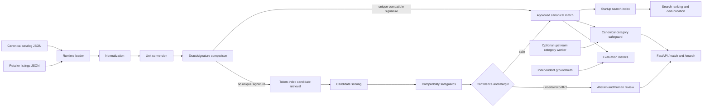

# Architecture

## Boundaries

- `normalization.py` handles text, aliases, units, and multipacks.
- `matcher.py` owns candidate scoring, hard incompatibilities, thresholds, and abstention.
- `category.py` prevents uncertain, timed-out, or conflicting upstream output from replacing a known canonical category.
- `search.py` indexes only approved identity matches and exposes ranking components.
- `evaluation.py` compares predictions with independently authored truth.
- `api.py` is a thin delivery layer over the same tested core used by the CLI.

The prototype intentionally uses immutable local JSON. It does not claim production durability, authentication, or distributed consistency.
